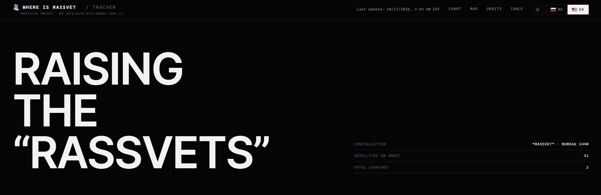
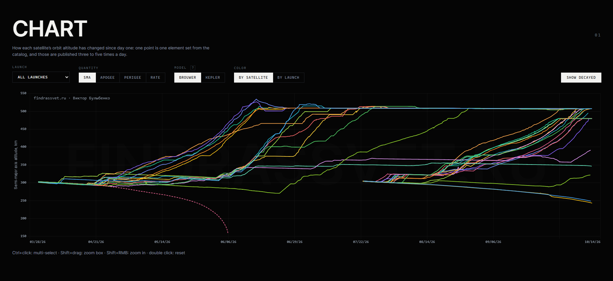
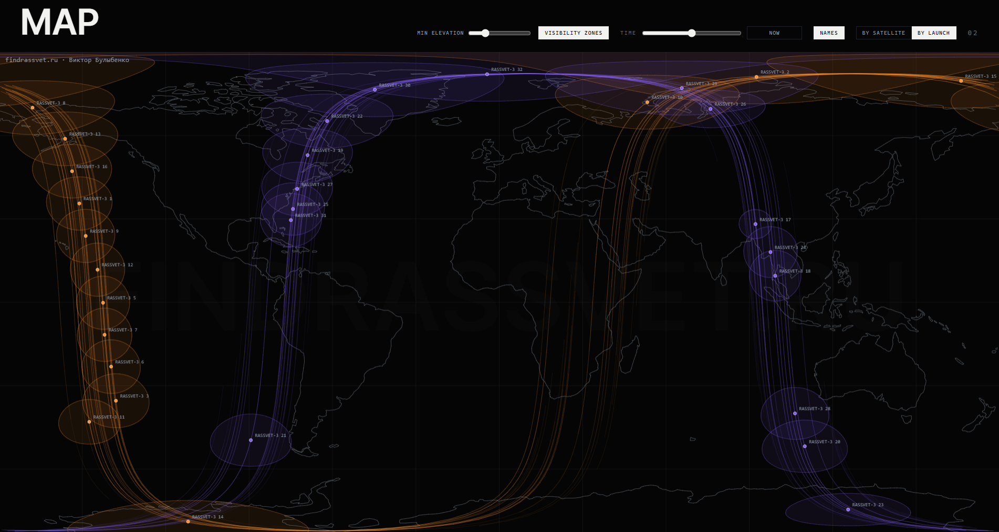
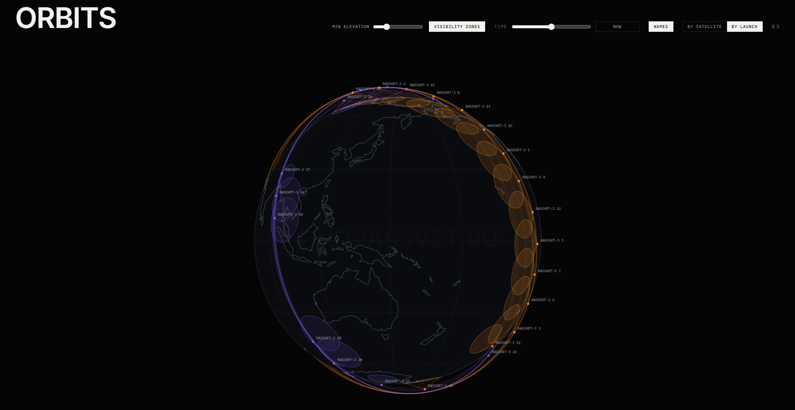
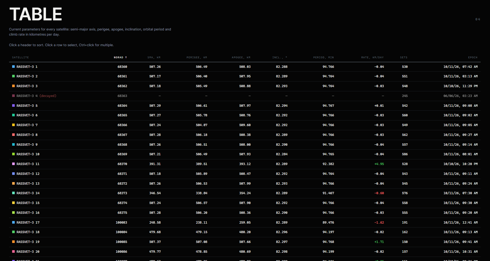

# findrassvet.ru – Rassvet constellation tracker

[Русский](README.ru.md)

**[findrassvet.ru](https://findrassvet.ru)** is a public tracker of orbit raising for Bureau 1440's Rassvet satellites. It shows each satellite's altitude, how fast it is climbing and where it is right now. Data come from the public NORAD catalog and update several times a day.

The site is unofficial and not affiliated with Bureau 1440 LLC.

## Features

- Semi-major axis altitude, apogee, perigee and orbit-raising rate (km/day) for every satellite since launch; colour by satellite or by launch, decayed satellites as dashed lines
- Map and 3D globe with current positions, ground tracks and coverage zones for a chosen elevation angle
- Time slider ±12 hours: positions, tracks and zones at any moment
- Satellite table with current altitude and rate
- Russian and English, dark and light themes, mobile layout

## History

- **8 August 2026** – site deployed.
- **9 August 2026** – public launch, [announcement on Goyda Space](https://t.me/goyda_space/1467).
- **29 August 2026** – update based on reader feedback ([post](https://t.me/goyda_space/1495)):
  - light theme;
  - orbit altitude rate chart;
  - satellite names on the map and globe even with nothing selected;
  - many smaller fixes.

More charts will come as the number of launches grows: for now there is too little data for them.

## Methodology

How altitude, raising rate and coverage zones are computed, why this way and how accurately: **[METHODOLOGY.md](METHODOLOGY.md)**. It also covers the finding that the separation of satellites into orbital planes is fully explained by nodal precession driven by their different altitude histories.

## Channels

- Tracker on Telegram: [t.me/findrassvet](https://t.me/findrassvet) – charts and constellation events
- Author: [Goyda Space](https://t.me/goyda_space)

## Data

Orbital elements come from the public NORAD catalog.

## Use

The methodology text and images in this repository are licensed under [CC BY 4.0](LICENSE): free to use with attribution "findrassvet.ru, V. Bulybenko". For academic work, use the "Cite this repository" button at the top right.

Questions and suggestions: [Issues](../../issues).
